# AI-Assisted Recruitment Intake — Architecture

**Candidate intake → resume evidence extraction → advisory assessment → authorized human review → interview or rejection workflow.**

## 1. Workflow at a glance

```mermaid
flowchart LR
    A["1. APPLICATION<br/>Candidate, role, resume URL,<br/>job description + notice flag"] --> B["2. VALIDATE<br/>Formats, lengths, Drive URL"]
    B -->|invalid| X["HTTP 400<br/>Invalid submission"]
    B -->|valid| C["3. DEDUPE<br/>Application ID in Sheets"]
    C --> D{"Existing application?"}
    D -->|yes| Y["202 EXISTING<br/>No second processing"]
    D -->|no| E["4. REGISTER<br/>Save intake state"]
    E --> F["5. RESUME PROCESSING<br/>Scoped Drive download → text"]
    F --> G["6. AI EVIDENCE EXTRACTION<br/>Structured, job-related facts"]
    G --> H["7. ADVISORY ASSESSMENT<br/>Evidence + uncertainty"]
    H --> I["8. HUMAN REVIEW<br/>Authorized reviewer form"]
    I --> J{"Reviewer choice"}
    J -->|hold| K["HOLD<br/>Manual handling"]
    J -->|reject| L["REJECT<br/>Human decision → message"]
    J -->|advance| M["9. INTERVIEW PREP<br/>Generate role-related questions"]
    M --> N["10. CALENDAR + EMAIL<br/>Create event and invite"]
    classDef intake fill:#f3f1ff,stroke:#7256bd,color:#16112b,stroke-width:1.5px
    classDef validate fill:#eef5ff,stroke:#4b79c7,color:#102343,stroke-width:1.5px
    classDef ai fill:#eef8f1,stroke:#45895b,color:#17351f,stroke-width:1.5px
    classDef human fill:#fff5e8,stroke:#d98a36,color:#4e2c0c,stroke-width:1.5px
    classDef output fill:#eff9f6,stroke:#238a77,color:#123a32,stroke-width:1.5px
    classDef error fill:#fff0f2,stroke:#cb5367,color:#571d29,stroke-width:1.5px
    class A,C,E,F intake
    class B,D validate
    class G,H,M ai
    class I,J human
    class K,L,N,Y output
    class X error
```

## 2. Decision boundary

AI extracts evidence and produces an **advisory** fit assessment only. An authorized human reviewer inspects the original material and chooses **advance**, **reject**, or **hold**. Only the human-selected rejection path sends a rejection message; advance prepares interview questions, calendar event, and invitation.

## 3. Input and outputs

| Input | Outputs |
|---|---|
| Candidate name/email, position, application ID, HTTPS Drive resume URL, job description, privacy acknowledgement flag | Extracted evidence, advisory assessment, reviewer decision, interview questions/event/invitation or rejection/hold record |

The privacy flag is only a submitted boolean; it does not prove notice or lawful consent. The template's interview time is fixed and must be replaced with real availability handling.

## 4. Services used

`n8n` · `Google Drive` resume access · `Google Sheets` application register · `Google Gemini` extraction/assessment · `Gmail` HR and candidate messages · `Calendar` interview event · `Slack` HR notification.

## 5. Security and fairness notes

- The source intake webhook has no authentication configured; secure it before any live use. The reviewer form also requires separate access controls.
- Resume URL validation does not prove ownership or file safety. Restrict Drive scope, validate MIME/size/pages, and scan uploads.
- Candidate data are high-impact personal data. Minimize, protect, retain only as needed, and review provider handling before model use.
- Never let model scores decide hiring. Test job-relatedness, accessibility, bias/disparate impact, and provide a human-led review and recourse process.

> **Portfolio output:** 42 nodes and 37 connection groups in the sanitized export. Synthetic resumes only for demos.
